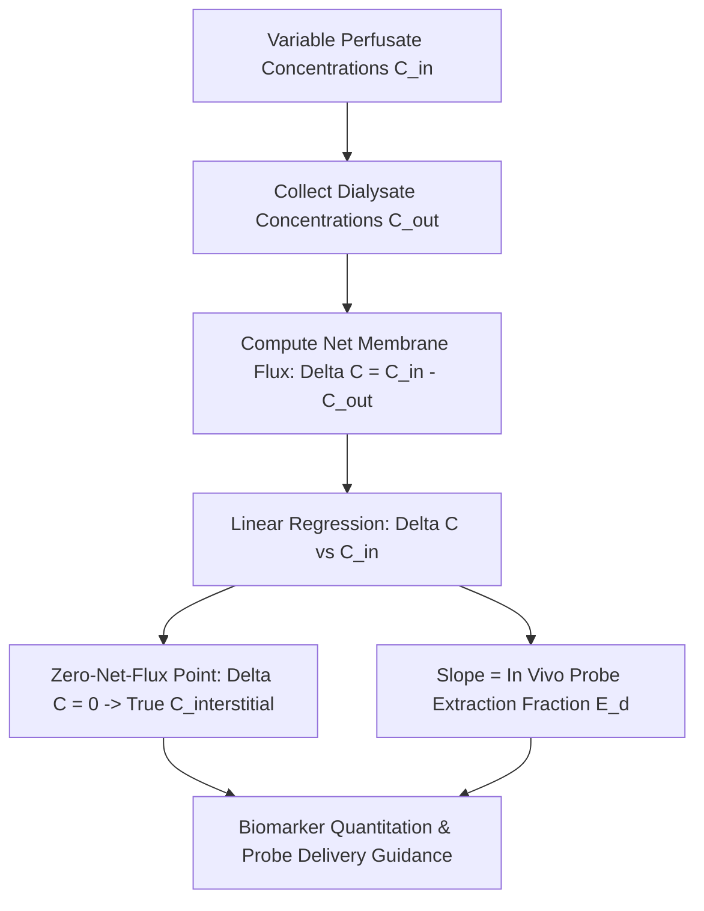

# Cutaneous Microdialysis Perfusion Recovery Skill

[](LICENSE)
[](https://www.python.org/)
[](https://openclaw.org/)
[](https://alphapark.ai/)
[](https://modelcontextprotocol.io/)

Cutaneous Microdialysis In Vivo Relative Recovery and Zero-Net-Flux (ZNF) Quantitative Analyzer based on Bungay transport modeling.



## Features
- **Zero PIP Dependencies**: Implemented strictly with Python Standard Library (`math`, `json`, `sys`, `typing`).
- **Zero-Net-Flux Method**: Determines exact interstitial concentrations independent of unknown tissue tortuosity or probe fouling.
- **Bungay Transport Physics**: Validated against classic in vivo microdialysis mass-transfer equations.
- **Dual Architecture**: Native Python import and Model Context Protocol (MCP) JSON-RPC 2.0 stdio server.

## Quickstart
```bash
python example_usage.py
```

## License
Apache-2.0
